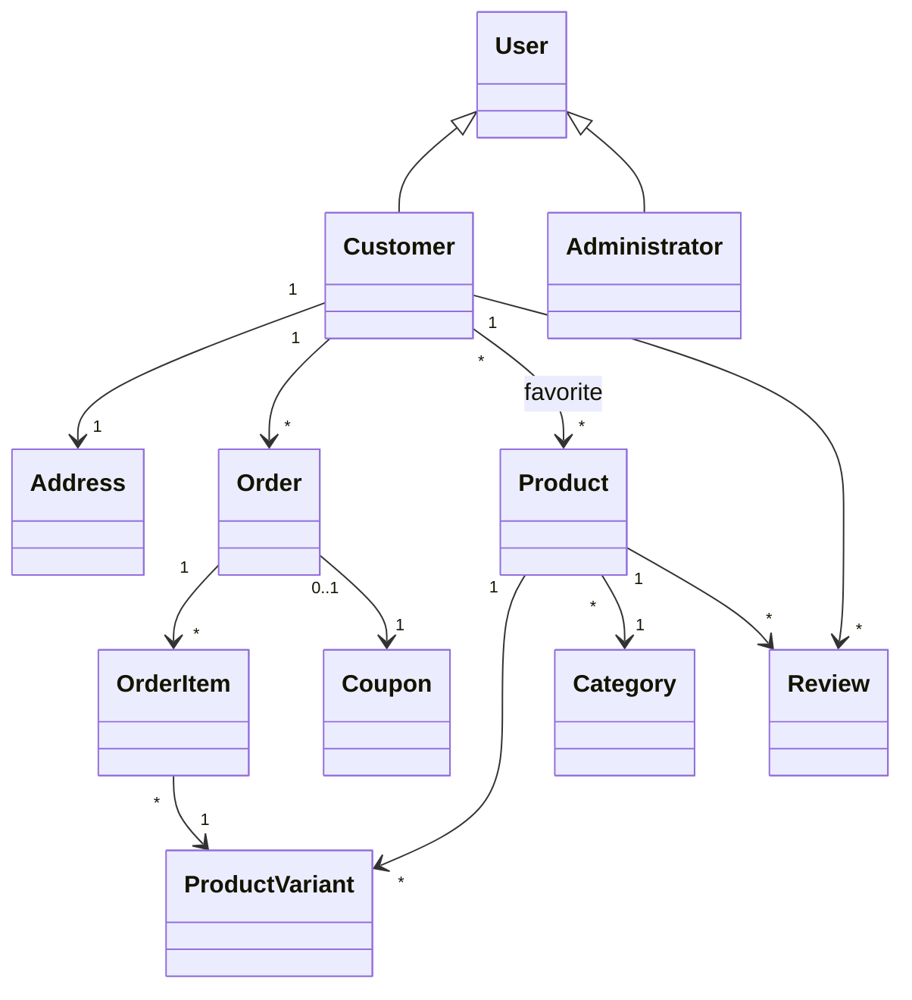
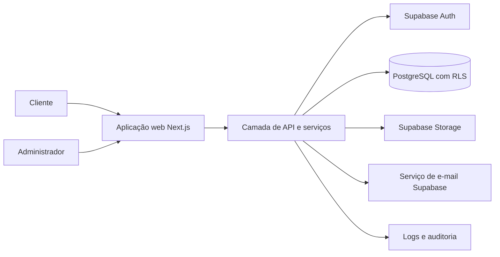

# FitStore E commerce de Produtos para Academia

**Versão:** 1.0  
**Status:** PLANEJAMENTO APROVADO

## Identificação do Projeto

FitStore é uma loja virtual em português do Brasil para roupas, suplementos e acessórios de academia. O projeto acadêmico deve reproduzir os controles essenciais de uma operação comercial: catálogo com variações, estoque, checkout autenticado, frete regional, pagamento simulado, pedidos, promoções e administração. O objetivo é oferecer uma jornada confiável ao cliente e controle operacional ao administrador, mantendo requisitos e decisões rastreáveis antes da implementação.

## Escopo

- Cadastro, autenticação, confirmação de e-mail e recuperação de senha.
- Catálogo pesquisável e filtrável; produto com imagens, variações, preço, estoque, descrição e informações específicas.
- Carrinho persistente, um endereço por cliente, checkout e pagamento simulado por PIX, cartão ou boleto.
- Frete por faixas regionais configuráveis: São Paulo, demais Sudeste, Sul/Centro-Oeste e Norte/Nordeste.
- Pedido, histórico, notificações por e-mail, cancelamento antes do envio e avaliações pós-entrega.
- Favoritos, objetivos de treino e recomendações explicáveis por navegação, compras, categorias e objetivos.
- Administração de usuários, catálogo, estoque, frete, cupons, promoções e pedidos.
- Uso proposto de Supabase para PostgreSQL, Auth, Storage e e-mails; imagens no Storage.

## Fora de Escopo

- Cobrança financeira real, integração com gateway, emissão fiscal e validação oficial de CPF.
- FitScore, assinaturas recorrentes de suplementos e comunidade integrada.
- Integrações com transportadoras, rastreamento real, múltiplos endereços, marketplace e aplicativo nativo.
- IA externa ou perfilamento não explicável para recomendações.

## Stakeholders e Atores

| Ator | Papel e objetivo | Permissões principais |
|---|---|---|
| Cliente | Descobrir e comprar produtos fitness | Conta própria, catálogo, carrinho, checkout, pedidos, favoritos e avaliações elegíveis |
| Administrador | Operar a loja | Gerir catálogo, estoque, pedidos, frete, cupons, usuários e administradores |
| Professor/equipe | Avaliar e construir o projeto | Consultar documentação e evidências de rastreabilidade |
| Supabase | Plataforma gerenciada | Autenticação, dados, armazenamento, e-mail e controles de acesso |

## Requisitos Funcionais

| ID | Requisito | Atores | Prioridade | Critérios de aceitação |
|---|---|---|---|---|
| RF-001 | Cadastro e acesso | Cliente | MUST | Cadastro exige nome, e-mail, senha, telefone, CPF formatado e endereço; e-mail é confirmado antes do checkout. |
| RF-002 | Administração de contas | Administrador | MUST | Primeiro administrador é promovido manualmente; administrador pode promover ou desativar outros administradores. |
| RF-003 | Catálogo e descoberta | Cliente | MUST | Exibe roupas, suplementos e acessórios; permite busca e filtros por categoria, marca, preço e objetivo. |
| RF-004 | Produto e variações | Cliente, Administrador | MUST | Produto exibe imagens, detalhes e variações; estoque e preço podem ser definidos por variação. |
| RF-005 | Carrinho | Cliente | MUST | Adiciona, remove e altera quantidades somente até o estoque disponível; mantém dados da sessão/conta. |
| RF-006 | Checkout e frete | Cliente | MUST | Usa endereço único, calcula faixa regional e apresenta prazo/valor antes da confirmação. |
| RF-007 | Pagamento simulado | Cliente | MUST | Cliente escolhe PIX, cartão ou boleto e aprova a simulação; aprovação cria pedido e reduz estoque atomicamente. |
| RF-008 | Gestão de pedidos | Cliente, Administrador | MUST | Status: pendente, pagamento aprovado, em preparação, enviado, entregue, cancelado; administrador altera status permitido. |
| RF-009 | Cancelamento e reposição | Cliente, Administrador | MUST | Cancelamento é permitido antes de enviado e repõe o estoque da variação. |
| RF-010 | Catálogo administrativo | Administrador | MUST | CRUD de categorias, produtos, variações, imagens, estoque e destaques. |
| RF-011 | Cupons e promoções | Administrador, Cliente | SHOULD | Cupom percentual tem validade, valor mínimo e limite de uso, com validação no checkout. |
| RF-012 | Favoritos e avaliações | Cliente | SHOULD | Cliente salva favoritos; só avalia produto de pedido entregue, com nota de 1 a 5 e comentário. |
| RF-013 | Recomendações | Cliente | SHOULD | Sugere itens por eventos de visualização, compras, categorias e objetivo de treino, com explicação simples. |
| RF-014 | Notificações | Cliente | SHOULD | E-mails de confirmação, recuperação de senha, pedido criado, alteração de status e cancelamento. |
| RF-015 | Configuração de frete | Administrador | MUST | Admin configura valor e prazo das quatro regiões de frete. |
| RF-016 | Auditoria operacional | Administrador | SHOULD | Alterações críticas de estoque, pedido, cupom e papel administrativo são registradas. |

## Requisitos Não Funcionais

| ID | Requisito verificável |
|---|---|
| RNF-001 | Autorização é aplicada no servidor e no banco; cliente acessa somente seus próprios dados. |
| RNF-002 | Senhas não são armazenadas pela aplicação; autenticação e tokens são providos pelo Supabase Auth. |
| RNF-003 | CPF é formatado e validado apenas quanto à estrutura esperada; não é enviado a serviços externos. |
| RNF-004 | Operações de aprovação/cancelamento preservam consistência de pedido, estoque e uso de cupom em transação. |
| RNF-005 | Páginas principais devem ser responsivas e navegáveis por teclado, com rótulos acessíveis. |
| RNF-006 | Listagens usam paginação; consultas de catálogo e pedidos possuem índices definidos no modelo de dados. |
| RNF-007 | Erros técnicos são registrados sem senha, token ou dados pessoais sensíveis. |
| RNF-008 | Datas são persistidas em UTC e exibidas no fuso America/Sao_Paulo; valores monetários usam BRL. |
| RNF-009 | Backup, recuperação e disponibilidade seguem o plano contratado do Supabase; restauração deve ser testada antes de uso real. |
| RNF-010 | Toda API relevante valida entrada, retorna erro sem vazar detalhes internos e possui testes de autorização. |

## Regras de Negócio

| ID | Regra | RF relacionados |
|---|---|---|
| RN-001 | Apenas usuário com e-mail confirmado pode iniciar checkout. | RF-001, RF-006 |
| RN-002 | O cliente mantém um único endereço de entrega ativo. | RF-001, RF-006 |
| RN-003 | Variação sem estoque permanece visível como indisponível e não pode entrar no carrinho. | RF-004, RF-005 |
| RN-004 | Pagamento simulado aprovado reduz estoque; cancelamento antes de enviado o repõe. | RF-007, RF-009 |
| RN-005 | Pedido segue a máquina de estados aprovada; depois de enviado não é cancelável pelo cliente. | RF-008, RF-009 |
| RN-006 | Cupom percentual exige validade, valor mínimo e saldo de usos; um cupom é aplicado por pedido. | RF-011 |
| RN-007 | Avaliação exige compra daquele produto em pedido entregue; uma avaliação por cliente e produto. | RF-012 |
| RN-008 | Recomendações usam somente dados internos de navegação e compra e devem expor seu motivo. | RF-013 |
| RN-009 | Administradores podem promover e desativar administradores; a implementação deve impedir que a operação deixe a loja sem administrador ativo. | RF-002 |

## Casos de Uso

| ID | Caso de uso | Ator | Fluxo e exceções | RF/RN |
|---|---|---|---|---|
| UC-001 | Criar conta e confirmar e-mail | Cliente | Cadastra, recebe e confirma e-mail; dados inválidos ou e-mail duplicado impedem criação. | RF-001, RN-001 |
| UC-002 | Descobrir produto | Cliente | Busca/filtra, visualiza produto e variação; evento de navegação alimenta recomendações. | RF-003, RF-004, RF-013 |
| UC-003 | Realizar compra | Cliente | Monta carrinho, calcula frete, aplica cupom, escolhe método e aprova pagamento; falta de estoque ou cupom inválido interrompe. | RF-005 a RF-007, RF-011, RN-003 a RN-006 |
| UC-004 | Acompanhar ou cancelar pedido | Cliente | Consulta histórico; cancela somente antes de enviado. | RF-008, RF-009, RN-005 |
| UC-005 | Administrar catálogo | Administrador | Cria/edita produto, variações, imagens e estoque; alterações são auditáveis. | RF-004, RF-010, RF-016 |
| UC-006 | Operar pedido | Administrador | Atualiza apenas transições permitidas e cliente é notificado. | RF-008, RF-014, RF-016 |
| UC-007 | Avaliar produto | Cliente | Após entrega, envia nota e comentário; sem pedido entregue, operação é recusada. | RF-012, RN-007 |
| UC-008 | Administrar acesso | Administrador | Promove/desativa contas respeitando o invariante de ao menos um administrador ativo. | RF-002, RN-009 |

## Modelo Conceitual do Domínio

Agregados principais: **Pedido** (itens, endereço histórico, pagamento e transições), **Produto** (variações e imagens) e **Cliente** (perfil/endereço). Invariantes: estoque nunca negativo; pedido cancelado antes de envio recompõe estoque uma única vez; avaliação elegível é única; ao menos um administrador ativo permanece disponível.

## Modelo Inicial de Dados

| Tabela | Atributos e restrições principais |
|---|---|
| profiles | id PK/FK auth.users, nome, telefone, cpf_formatado, role, email_confirmed_at, ativo, timestamps |
| addresses | customer_id PK/FK, CEP, logradouro, número, complemento, bairro, cidade, UF, região_frete |
| categories | id PK, nome único, slug único, ativa |
| products | id PK, category_id FK, nome, slug único, marca, descrição, objetivo_treino, ativo, destaque |
| product_variants | id PK, product_id FK, atributos JSON, sku único, preço_em_centavos, estoque, ativo |
| product_images | id PK, product_id FK, storage_path, ordem, alt_text |
| carts/cart_items | customer_id, variant_id, quantidade; unicidade por carrinho e variação |
| shipping_regions | id PK, nome, UFs/CEP aplicáveis, valor_em_centavos, prazo_dias, ativo |
| coupons | código único, percentual, início/fim, mínimo_em_centavos, limite_uso, usos, ativo |
| orders/order_items | cliente, status, totais, endereço e frete históricos; itens guardam preço e nome no momento da compra |
| reviews | customer_id, product_id, order_id, nota 1..5, comentário; único customer_id/product_id |
| favorites | customer_id, product_id; PK composta |
| browsing_events | customer_id, product_id, tipo, occurred_at; retenção a definir |
| audit_logs | ator, ação, entidade, entidade_id, metadados mínimos, occurred_at |

Índices iniciais: slug de produto, categoria/ativo, variação por produto, pedido por cliente/data/status, eventos por cliente/data e cupom por código. Políticas RLS restringem linhas de cliente ao titular; ações administrativas exigem papel administrador no banco e na aplicação.

## Arquitetura Proposta

Adotar monólito web em camadas com frontend e camada de API no mesmo repositório, preferencialmente **Next.js com TypeScript**. Conforme decisão aceita no ADR-001, o MVP usa Route Handlers; NestJS permanece alternativa para evolução futura. Supabase concentra PostgreSQL, Auth, Storage e e-mail. Regras críticas de estoque/pedido devem residir em serviço transacional e/ou função de banco, nunca apenas no cliente.

Erros de domínio retornam respostas previsíveis; erros inesperados são logados com identificador de correlação. Processamentos de e-mail são disparados após mudanças confirmadas de estado; nenhuma integração de pagamento ou logística real faz parte desta versão.

## APIs Planejadas

| Método e rota | Finalidade | Autorizado | RF/UC |
|---|---|---|---|
| GET /api/products | Lista e filtra catálogo paginado | Público | RF-003, UC-002 |
| GET /api/products/:slug | Detalha produto e registra visualização autenticada | Público/Cliente | RF-004, RF-013 |
| GET/PUT /api/cart | Consulta e altera carrinho | Cliente | RF-005, UC-003 |
| POST /api/checkout/quote | Calcula frete e valida cupom | Cliente confirmado | RF-006, RF-011 |
| POST /api/orders | Aprova pagamento simulado e cria pedido | Cliente confirmado | RF-007, UC-003 |
| GET /api/orders e /:id | Histórico/detalhe do próprio pedido | Cliente | RF-008, UC-004 |
| POST /api/orders/:id/cancel | Cancela pedido elegível | Cliente/Admin | RF-009, UC-004 |
| POST /api/products/:id/reviews | Cria avaliação elegível | Cliente | RF-012, UC-007 |
| GET /api/recommendations | Obtém sugestões explicáveis | Cliente | RF-013, UC-002 |
| /api/admin/* | Catálogo, pedidos, frete, cupons e usuários | Administrador | RF-002, RF-010, RF-015, UC-005, UC-006, UC-008 |

Todas as entradas são validadas; respostas relevantes incluem 400 (dados inválidos), 401 (não autenticado), 403 (sem permissão), 404, 409 (conflito de estoque/transição) e 422 (regra de negócio).

## Tecnologias Sugeridas

| Tecnologia | Finalidade | Vantagens e limitação |
|---|---|---|
| Next.js + TypeScript | Interface e API do MVP | Ecossistema React e entrega integrada; requer disciplina para não concentrar regra crítica no cliente. |
| Supabase | PostgreSQL, Auth, Storage, e-mail | Serviço gerenciado, RLS e integração rápida; cria dependência do provedor. |
| Tailwind CSS | Interface responsiva | Consistência e velocidade; exige convenções visuais. |
| Zod | Validação de contratos | Reuso entre interface e API; não substitui RLS. |
| Vitest/Playwright | Testes unitários e E2E | Cobertura rápida e fluxo real; E2E é mais lento. |

Alternativas: NestJS separado oferece fronteira de backend mais rígida, mas aumenta complexidade do MVP; PostgreSQL autogerenciado reduz dependência do fornecedor, mas amplia operação sem necessidade acadêmica atual.

## Estratégia de Segurança

Supabase Auth gerencia credenciais, verificação e recuperação. A aplicação valida sessão e papel em toda ação privada; RLS impede acesso indevido mesmo se a API for contornada. Chaves privilegiadas ficam apenas no ambiente servidor. Aplicar validação de entrada, limites de requisição para login/endpoints sensíveis, URLs assinadas ou políticas restritas para imagens, registros de auditoria e minimização de dados. CPF não é usado para decisão fiscal e não é validado externamente.

## Estratégia de Testes

- Unitários: preços, frete, cupom, transições, estoque, elegibilidade de avaliação e recomendações.
- Integração: RLS, persistência, transações de aprovação/cancelamento e Storage.
- API: autenticação, autorização, validação, erros e contratos.
- E2E: cadastro/confirmação, compra, administração, cancelamento e avaliação.
- Segurança: tentativas de acesso cruzado entre clientes, escalada de papel e exposição de segredos.

## Riscos

| Risco | Probabilidade/impacto | Mitigação |
|---|---|---|
| Estoque inconsistente em compras simultâneas | Média/Alta | Transação/lock atômico e testes concorrentes. |
| RLS configurada incorretamente | Média/Alta | Política por tabela, testes de acesso cruzado e revisão. |
| Escopo acadêmico crescer com novas exigências | Alta/Média | Registrar pendências, ADRs e novas TASKs antes de alterar escopo. |
| E-mail não chegar em ambiente de teste | Média/Média | Configurar domínio/testes e apresentar estado de confirmação no sistema. |
| Recomendações pouco relevantes | Média/Baixa | Regra explicável simples, métricas e degradação para produtos populares. |

## Roadmap

| Fase | Objetivo | Entregáveis e conclusão |
|---|---|---|
| PHASE-01 | Fundação | Repositório, convenções, dados, Auth/RLS e checkpoint aprovados. |
| PHASE-02 | Catálogo | Dados de produtos, Storage e descoberta funcionando e testados. |
| PHASE-03 | Compra | Carrinho, frete, cupom, pedido e estoque transacional validados. |
| PHASE-04 | Operação | Administração, notificações, avaliações e recomendações concluídas. |

## Matriz de Rastreabilidade

| RF | RN | RNF | UC | Entidade | API | Teste | TASK |
|---|---|---|---|---|---|---|---|
| RF-001 | RN-001 | RNF-001,002 | UC-001 | profiles, addresses | auth/profile | integração Auth/RLS | TASK-003,004 |
| RF-003,004 | RN-003 | RNF-005,006 | UC-002 | products, variants, images | products | unit/API/E2E catálogo | TASK-006,007 |
| RF-005 a 007 | RN-002 a 006 | RNF-004,010 | UC-003 | carts, orders, items, coupons | cart/checkout/orders | integração transação/E2E compra | TASK-009 a 012 |
| RF-008,009 | RN-004,005 | RNF-004,007 | UC-004,006 | orders, audit_logs | orders/admin orders | unit/API/E2E status | TASK-012,013 |
| RF-010,015,016 | RN-009 | RNF-001,007 | UC-005,008 | catálogo, regiões, audit | admin | API autorização | TASK-008,014 |
| RF-012,013,014 | RN-007,008 | RNF-001,007 | UC-007 | reviews, events | reviews/recommendations | unit/API/E2E | TASK-015 a 017 |

## Pendências

| ID | Descrição | Impacto e condição |
|---|---|---|
| PD-001 | Requisitos acadêmicos posteriores do professor | Pode alterar apresentação, documentação ou stack; incorporar por decisão aprovada. |
| PD-002 | Escolha final Route Handlers versus NestJS | ENCERRADA pelo ADR-001 aceito: Route Handlers no MVP; NestJS é alternativa futura. |
| PD-003 | Detalhes de design visual e identidade da loja | Afeta interface, não regras de domínio; resolver antes de UI final. |
| PD-004 | Retenção de eventos de navegação | Afeta privacidade e custo; definir antes de produção/uso externo. |
