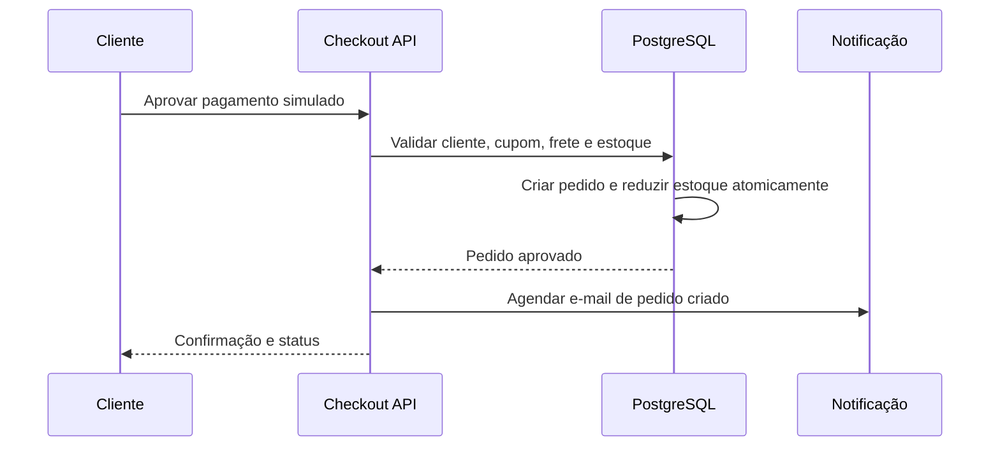
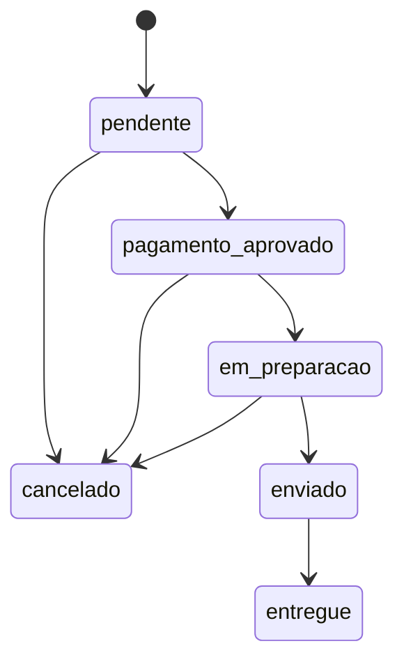

# Arquitetura da FitStore

## Módulos

| Módulo | Responsabilidade |
|---|---|
| identity | Perfil, sessão, confirmação e papéis. |
| catalog | Categorias, produtos, variações, imagens, busca e filtros. |
| cart | Carrinho e validação de disponibilidade. |
| checkout | Frete, cupom, preço e aprovação simulada. |
| orders | Pedido, estados, cancelamento, reposição e histórico. |
| administration | Gestão operacional e auditoria. |
| engagement | Favoritos, avaliações, eventos e recomendações. |
| notifications | Disparo e rastreio de comunicações transacionais. |

## Estrutura inicial do repositório

- `src/app/`: páginas e layouts do App Router do Next.js. A página inicial é apenas um placeholder acessível, sem fluxo de compra.
- `src/lib/`: código compartilhável sem regra de negócio; novos módulos devem permanecer separados conforme a tabela acima.
- `src/**/*.test.ts`: testes unitários executados pelo Vitest.
- `docs/`: requisitos, decisões, arquitetura e documentação operacional.

As rotas de API e os módulos de domínio serão adicionados pelas TASKs que os autorizam; esta estrutura inicial não cria endpoints, persistência ou autenticação.

## Desenvolvimento e qualidade

Requisitos locais: Node.js 20.9 ou superior e npm. Instale as dependências com `npm install`; os comandos definidos no `package.json` são:

| Comando | Uso |
|---|---|
| `npm run dev` | Servidor local de desenvolvimento. |
| `npm run lint` | Verificação estática com ESLint e regras recomendadas de JavaScript/TypeScript. |
| `npm test` | Execução única dos testes unitários com Vitest. |
| `npm run build` | Compilação de produção do Next.js. |

Execute os comandos de validação manualmente no ambiente Windows/WSL/Linux e registre saída, resultado e evidência conforme o roteiro da TASK. Nunca coloque segredos em arquivos versionados; `.env` é ignorado pelo Git.

## Fronteiras e dados

Componentes de interface usam APIs internas; as APIs chamam serviços de domínio; serviços acessam Supabase. O cliente jamais recebe chave privilegiada. Dados de pedido preservam um retrato de itens, preço, desconto, frete e endereço para que alterações futuras no catálogo não mudem o histórico.

## Sequência de aprovação do pedido

## Transições de pedido

O caminho de cancelamento repõe estoque apenas quando a redução já ocorreu. Toda transição é autorizada pelo ator e validada no servidor.
