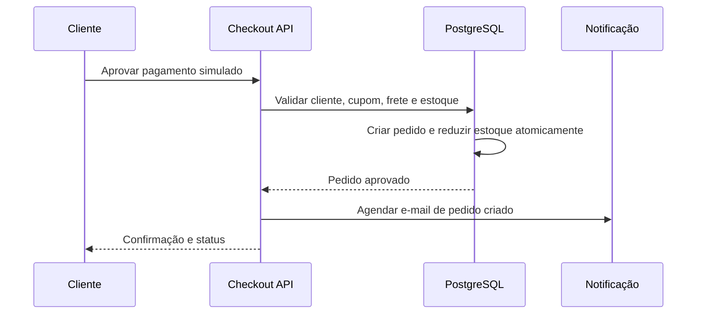
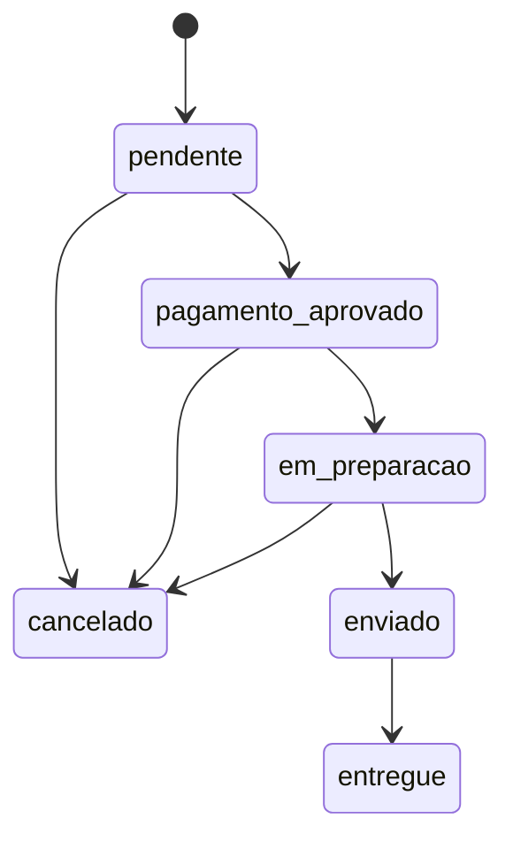

# Arquitetura da FitStore

## Módulos

| Módulo | Responsabilidade |
|---|---|
| identity | Perfil, sessão, confirmação e papéis. |
| catalog | Categorias, produtos, variações, imagens, busca e filtros. |
| cart | Carrinho e validação de disponibilidade. |
| checkout | Frete, cupom, preço e aprovação simulada. |
| orders | Pedido, estados, cancelamento, reposição e histórico. |
| administration | Gestão operacional e auditoria. |
| engagement | Favoritos, avaliações, eventos e recomendações. |
| notifications | Disparo e rastreio de comunicações transacionais. |

## Fronteiras e dados

Componentes de interface usam APIs internas; as APIs chamam serviços de domínio; serviços acessam Supabase. O cliente jamais recebe chave privilegiada. Dados de pedido preservam um retrato de itens, preço, desconto, frete e endereço para que alterações futuras no catálogo não mudem o histórico.

## Sequência de aprovação do pedido

## Transições de pedido

O caminho de cancelamento repõe estoque apenas quando a redução já ocorreu. Toda transição é autorizada pelo ator e validada no servidor.
